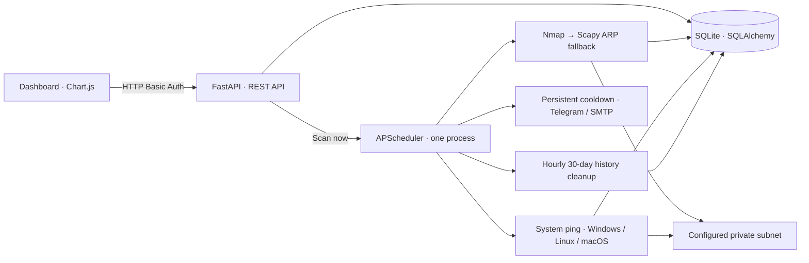
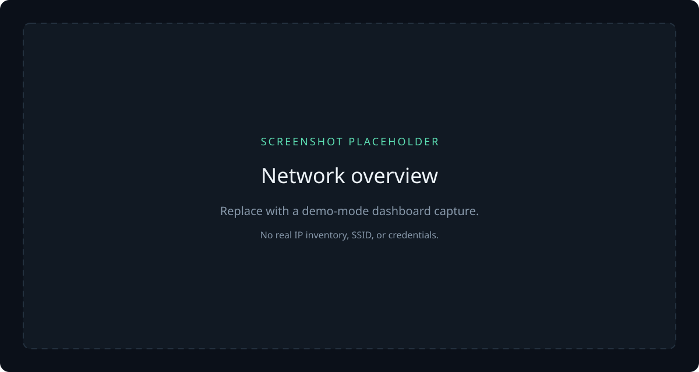
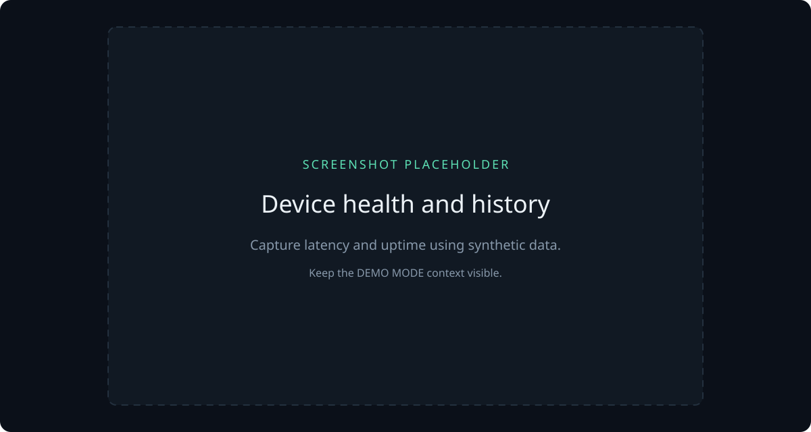

# Signal · Network Monitoring Dashboard

**Discover your private-network devices, track their health, and receive actionable alerts.**

[](https://github.com/johnpatrick1518/network-monitor/actions/workflows/ci.yml)
[](LICENSE)

> This is a locally run application, not a hosted monitoring service. The CI badge links to the repository's actual GitHub Actions results; public source code does not expose your local dashboard.

## Demo mode in 60 seconds

With Python 3.11+ installed, run from this folder:

**Windows · PowerShell**

```powershell
py -m venv .venv
.\.venv\Scripts\python.exe -m pip install -r requirements.txt
.\.venv\Scripts\python.exe -m app.demo
```

**Linux / macOS**

```bash
python3 -m venv .venv
.venv/bin/python -m pip install -r requirements.txt
.venv/bin/python -m app.demo
```

Open **<http://localhost:8000>**, sign in as **`demo`**, and use the temporary password displayed in the terminal. Dependency download time depends on your connection. No `.env`, Nmap, raw-socket privileges, Telegram account, or LAN access is required. Use `--port 8001` if port 8000 is occupied; stop with `Ctrl+C`.

The launcher enables `DEMO_MODE=true`, binds only to loopback, and generates a new random password for each run. It does not modify `.env`. A separate `data/demo.db` contains eight clearly labeled synthetic devices and seven days of synthetic history; your live database remains untouched. Existing demo edits persist across restarts.

To reset an old demo and regenerate recent chart history, stop the app and remove only `data/demo.db` before launching it again. Never remove your live inventory database.

Try filtering Unknown devices, renaming one, marking it Trusted, viewing 1h/24h/7d history, exporting CSV, and pressing **Send test alert**. A simulated printer cycles through outages and recovery as checks run every 10 seconds. Alerts exercise the normal persisted cooldown path but **never send Telegram messages or email**, even if real credentials exist in `.env`. Demo mode does not call Nmap, Scapy, DNS, system ping, or Wi-Fi metadata commands.

To enable demo mode with your own Uvicorn command instead, set `DEMO_MODE=true` and configure dashboard credentials normally. `DEMO_DATABASE_URL` overrides `DATABASE_URL` while demo mode is enabled; do not point it at an existing live database.

## Architecture

Signal runs as one FastAPI process: APScheduler discovers hosts with Nmap (or a Scapy ARP fallback), system `ping` checks their health, SQLAlchemy stores inventory and observations in SQLite, and Telegram/SMTP delivers rate-limited notifications. A protected, no-build HTML/CSS/JavaScript dashboard polls the REST API every 10 seconds and uses CDN-loaded Chart.js for history. Scans are restricted to a single configured RFC1918 private IPv4 subnet.



See [docs/architecture.md](docs/architecture.md) for the data flow, transaction boundaries, state machine, demo adapters, and tradeoffs.

## Features

- Immediate startup discovery, then every 5 minutes; manual **Scan now**.
- Auto-detected private subnet or explicit CIDR in `.env`.
- Connected Wi-Fi name (SSID), adapter, and Windows signal strength shown alongside the subnet.
- IP, MAC, bounded reverse-DNS lookups, offline MAC-OUI vendor lookup, first/last seen.
- MAC-based identity across DHCP address changes when MAC information is available.
- Parallel, shell-free system ping every 60 seconds; configurable concurrency and timeout.
- Raw ping history, debounced up/down state, latency, and observed 24h/7d/30d uptime.
- Three consecutive misses before a down event; recovery alerts include elapsed downtime.
- Unknown-device alerts and reminders until marked Trusted.
- Telegram primary notifications and optional SMTP; persistent per-device/per-event cooldown.
- Friendly names, tags, trust controls, searchable/sortable/filterable inventory.
- Responsive dark dashboard, optional light theme, device modal, 1h/24h/7d latency chart, availability timeline.
- Activity feed with discovery, outage, recovery, scan-completed, and scan-failed events.
- Authenticated `/docs`, `/redoc`, REST API, and spreadsheet-safe CSV export.
- SQLite WAL, hourly retention cleanup, Docker host-network deployment, isolated pytest tests.
- Safe synthetic demo mode and a Ruff/pytest GitHub Actions matrix.

## Screenshots





These are deliberately labeled placeholders, not screenshots. Capture **demo mode** before publishing images so your real IP/MAC inventory, SSID, Telegram chat, and credentials are not exposed. See [screenshot instructions](docs/images/README.md). Real monitoring mode never injects demo devices.

## Prerequisites

- Python **3.11+** and pip, or Docker Engine with Compose.
- Nmap executable on `PATH` (the `python-nmap` dependency is only its Python wrapper).
- An ICMP `ping` command. Windows and macOS provide it; install `iputils-ping` on Linux.
- An owned/authorized **RFC1918 IPv4** network. Prefer a directly attached `/24`.
- Raw ARP privileges for Scapy fallback: root/capabilities on Linux, Administrator plus Npcap on Windows, or elevated privileges on macOS.
- Internet access for Telegram/SMTP and Chart.js CDN loading. Monitoring, tables, and the availability timeline still work if Chart.js cannot load.

## Setup

Run commands from the project root. **Copy `.env.example` to `.env`, then set a strong `DASHBOARD_PASSWORD` before starting.** The default example password is deliberately empty; startup refuses an empty password.

### Windows · PowerShell

Install Python from python.org and Nmap from <https://nmap.org/download.html>. Include **Npcap** in the Nmap installer and add Nmap to `PATH`; reopen PowerShell afterwards.

```powershell
py -m venv .venv
.\.venv\Scripts\python.exe -m pip install -r requirements.txt
Copy-Item .env.example .env
notepad .env
```

If auto-detection selects a VPN/virtual adapter, use `ipconfig` to find your actual LAN address and subnet mask, then set, for example, `SUBNET=192.168.1.0/24`. Do not copy that example unless it matches your network.

Start with this **one command**:

```powershell
.\.venv\Scripts\python.exe -m uvicorn app.main:app --host 127.0.0.1 --port 8000 --workers 1
```

If raw discovery fails, use an Administrator PowerShell and check Npcap. Normal ICMP probes usually do not need elevation. Windows Defender Firewall may need an inbound ICMP Echo rule on the **monitored device**, limited to its private network profile.

### Linux · Debian / Ubuntu

```bash
sudo apt-get update
sudo apt-get install -y python3 python3-venv nmap iputils-ping libpcap0.8
python3 -m venv .venv
.venv/bin/python -m pip install -r requirements.txt
cp .env.example .env
nano .env
```

Start with this **one command**:

```bash
.venv/bin/python -m uvicorn app.main:app --host 127.0.0.1 --port 8000 --workers 1
```

Unprivileged Nmap discovery is supported, but may find fewer hosts. For reliable local ARP discovery, prefer the capability-limited Docker deployment below. If a local elevated run is necessary on a trusted machine, use the explicit venv interpreter:

```bash
sudo .venv/bin/python -m uvicorn app.main:app --host 127.0.0.1 --port 8000 --workers 1
```

Running the web server as root increases risk. Do not grant broad capabilities to a general-purpose Python interpreter. If `ping` itself reports a permissions error, fix the distro's `iputils-ping` installation/capabilities rather than treating the resulting error as device downtime.

### macOS

Install Python 3.11+ and Nmap with Homebrew:

```bash
brew install python nmap
python3 -m venv .venv
.venv/bin/python -m pip install -r requirements.txt
cp .env.example .env
nano .env
```

Start with this **one command**:

```bash
.venv/bin/python -m uvicorn app.main:app --host 127.0.0.1 --port 8000 --workers 1
```

For raw ARP fallback, an elevated invocation may be required:

```bash
sudo .venv/bin/python -m uvicorn app.main:app --host 127.0.0.1 --port 8000 --workers 1
```

Native execution is recommended over Docker Desktop for layer-2 LAN discovery on macOS.

### Open the dashboard

Visit **<http://localhost:8000>** and enter the username/password from `.env`. Every page, static asset, documentation route, and API endpoint requires the same credentials.

The first scan is scheduled immediately. On a typical `/24` with working discovery tools, devices appear within a minute and the first ping samples follow immediately. Larger networks, blocked discovery, slow DNS, or missing privileges can take longer. The dashboard shows discovery failures instead of inventing offline devices.

Stop with `Ctrl+C`. Shutdown waits for running jobs; an in-flight Nmap invocation can take up to 90 seconds.

**Always run exactly one Uvicorn worker and one app instance per database/subnet.** Do not use multiple workers, multiple replicas, or production `--reload`: the scheduler is intentionally in-process.

## Configuration

Environment variables override `.env`. Restart the process after changing settings.

| Variable | Default | Purpose |
|---|---|---|
| `DEMO_MODE` | `false` | Synthetic discovery/probes and simulated alerts; no real network operations |
| `DEMO_DATABASE_URL` | `sqlite:///./data/demo.db` | Separate demo SQLite storage; overrides `DATABASE_URL` in demo mode |
| `SUBNET` | empty | Auto-detect, or a private IPv4 CIDR such as your actual `/24` |
| `SCAN_INTERVAL_SECONDS` | `300` | Discovery interval, minimum 30 |
| `PING_INTERVAL_SECONDS` | `60` | Health interval, minimum 5 |
| `PING_TIMEOUT_SECONDS` | `2` | Per-probe network timeout; subprocess also has a hard deadline |
| `PING_WORKERS` | `32` | Concurrent probes, maximum 128 |
| `DOWN_THRESHOLD` | `3` | Consecutive missed probes before offline |
| `ALERT_COOLDOWN_SECONDS` | `3600` | Cooldown per device/event kind, also used for the test button |
| `HISTORY_RETENTION_DAYS` | `30` | Sample/event retention, minimum 30; cleaned hourly |
| `DATABASE_URL` | `sqlite:///./data/network-monitor.db` | SQLite database location |
| `DASHBOARD_USERNAME` | `admin` | HTTP Basic username |
| `DASHBOARD_PASSWORD` | empty, required | Set a unique, strong password |
| `TELEGRAM_BOT_TOKEN` | empty | Telegram bot token |
| `TELEGRAM_CHAT_ID` | empty | Telegram recipient chat ID |
| `SMTP_HOST` | empty | SMTP server; empty disables email |
| `SMTP_PORT` | `587` | SMTP port |
| `SMTP_USERNAME`, `SMTP_PASSWORD` | empty | SMTP authentication, if required |
| `SMTP_FROM`, `SMTP_TO` | empty | Sender and recipient; both required for email |
| `SMTP_STARTTLS` | `true` | Upgrade SMTP to TLS |
| `SMTP_USE_SSL` | `false` | Implicit TLS, usually port 465; turn STARTTLS off when enabling |
| `LOG_LEVEL` | `INFO` | Standard Python logging level |

Auto-detection prefers the default-route interface, then an active RFC1918 interface. It cannot know which of several private VPN, container, Wi-Fi, or Ethernet networks you own. Inspect the displayed subnet and set `SUBNET` explicitly when needed. Ranges larger than `/16` are refused to bound accidental scan scope.

The dashboard also reads the monitoring computer's connected Wi-Fi name every 30 seconds, without scanning for nearby wireless networks or reading Wi-Fi passwords. Windows uses `netsh`; Linux optionally uses `iwgetid` or NetworkManager's `nmcli`; macOS uses OS network metadata. Wired connections, containers, missing tools, OS language differences, or location/privacy restrictions may expose only the interface/subnet. This name describes the host's connection, not the Wi-Fi used by every discovered device. Device names still come from friendly names or reverse DNS.

SMTP can be used alone or alongside Telegram. When both are configured both are attempted, Telegram first. A notification is considered sent if at least one configured channel succeeds; the cooldown then applies to the whole notification. Use provider-specific app passwords where required.

## Telegram bot and chat ID

1. Open Telegram, find the verified **@BotFather**, and send `/newbot`.
2. Choose a bot name and username; copy the issued token into `TELEGRAM_BOT_TOKEN` in `.env`. Keep it secret.
3. Open your new bot's chat and press **Start** or send `/start`. A bot cannot initiate a private conversation before you do this.
4. Inspect `getUpdates` from your own terminal:

   ```bash
   curl "https://api.telegram.org/bot<YOUR_BOT_TOKEN>/getUpdates"
   ```

   On PowerShell use `curl.exe` if `curl` is an alias. Replace the placeholder locally, not in a public issue or screenshot. This command may remain in shell history.

5. Find the message's `chat.id` in the JSON and copy it to `TELEGRAM_CHAT_ID`. For groups, add the bot and send a command addressed to it; group chat IDs are commonly negative.
6. Restart Signal and click **Send test alert**.

If updates are empty, send another message to the bot first. If another program uses this bot's webhook or consumes its updates, use a dedicated bot or temporarily stop that integration.

Tests are rate-limited too. A failed send uses a 30-second retry backoff, not the full successful-delivery cooldown. Failed transition notifications are logged but there is no durable retry queue; unknown-device reminders retry on later scans. Configure/test alerts before relying on them.

## Alerts and health semantics

- **New device:** initially Unknown; recorded immediately and notified after discovery.
- **Still Unknown:** reminders on later successful scans, subject to the same `unknown:<device>` cooldown, until marked Trusted.
- **Device down:** exactly one transition event after `DOWN_THRESHOLD` consecutive failed pings.
- **Device back up:** the first successful ping after a down transition; includes time since the first missed probe.
- **Cooldown:** independent keys for unknown, down, up, and test alerts. Repeated down/up cycles inside the cooldown can produce dashboard events without another outbound notification.
- **Trusted does not disable health alerts.** It only stops unknown-device reminders.
- Health samples record **each actual ping outcome**; dashboard state is **debounced**. Therefore uptime can decline while a device is still shown online after its first or second missed ping.
- Uptime is successful observed probes divided by all observed probes in the selected window, rounded to two decimals. No observations means `null`/`—`, not 100%. It is not a claim about time when the monitor was stopped.
- A missing `ping` binary or explicit local permission error is logged and skipped, not recorded as an outage.
- Discovery failures never change health state. Successful discovery updates `last_seen`, but only ping probes change health state.
- ICMP-blocking hosts, sleep mode, Wi-Fi client isolation, or devices outside your broadcast domain can limit discovery/health visibility.
- MAC OUI is offline and best-effort; locally administered/randomized MACs often have no meaningful vendor.
- On routed subnets, Nmap can find hosts but usually cannot retrieve remote MAC addresses; Scapy's ARP fallback is directly attached only.
- Known MACs follow DHCP moves. If a different MAC takes an existing IP, the old identity is retired from the active inventory; its history remains accessible by ID until retention removes old samples. If no MAC is available, identity is necessarily IP-based and cannot securely distinguish replacement devices.
- Chart history is bucketed to keep responses bounded: 5s for 1h, 60s for 24h, 5m for 7d. A bucket with any failed probe is marked down. Latency averages successful observations in the bucket; a mixed/down bucket is a chart gap. The timeline is a summary, not packet-level forensics.

## Docker

Set up `.env` first, including a non-empty dashboard password and preferably an explicit `SUBNET`.

On a **native Linux Docker host**:

```bash
docker compose up --build -d
```

Open <http://localhost:8000>. SQLite persists under `./data/`.

```bash
docker compose logs -f
```

```bash
docker compose down
```

Compose deliberately uses `network_mode: host`, so no `ports` mapping is necessary. It drops all Linux capabilities except `NET_RAW` and `NET_ADMIN`; it does not use `privileged: true`. The container runs as root to use those scoped capabilities.

**Host mode is not equivalent across platforms.** Docker Desktop's optional host networking is primarily layer 4 and does not guarantee raw layer-2 ARP access to your physical LAN. Windows/macOS users should run natively, or deploy on a Linux host/VM bridged directly onto the owned LAN. Rootless Docker can also restrict raw scanning. Do not assume enabling host mode in Desktop makes ARP discovery work.

The container binds `0.0.0.0:8000` on the host. Restrict access with the host firewall, and use a TLS reverse proxy for anything beyond a trusted local machine. The authenticated container health check tests HTTP/database availability, **not** discovery permission or Telegram connectivity.

## REST API

Interactive docs: <http://localhost:8000/docs>. Credentials are required.

| Method | Endpoint | Purpose |
|---|---|---|
| GET | `/api/devices` | Active devices and all uptime windows |
| GET | `/api/devices/{id}` | Device details |
| PATCH | `/api/devices/{id}` | Friendly name, tags, trust |
| GET | `/api/devices/{id}/history?range=1h\|24h\|7d` | Bucketed ping observations |
| POST | `/api/scan` | Queue discovery; `202`, `queued` or `busy` |
| GET | `/api/events` | Newest events, default 100, maximum 500 |
| GET | `/api/summary` | Counts, mean latency, scheduler and discovery diagnostics |
| POST | `/api/alerts/test` | Test notifications; inspect `status` and `channels` |
| GET | `/api/export/devices.csv` | UTF-8 CSV with spreadsheet-formula protection |

`/api/devices` supports `search`, `status=up|down|unknown`, `tag`, `trusted=true|false`, `sort=name|ip|mac|vendor|status|latency|uptime|last_seen`, and `descending=true|false`.

`/api/events` supports `limit`, `before_id` for pagination, and `device_id`.

Example: prompt for your dashboard password rather than including it in shell history:

```bash
curl -u admin http://localhost:8000/api/summary
```

Rename and trust a device:

```bash
curl -u admin -X PATCH http://localhost:8000/api/devices/1 \
  -H "Content-Type: application/json" \
  -d '{"friendly_name":"Home server","tags":["server"],"trusted":true}'
```

The last example is for Bash/zsh; use `Invoke-RestMethod` or suitable JSON quoting in PowerShell.

## Run tests

Install development tools once:

```bash
python -m pip install -r requirements-dev.txt
```

Use your virtual environment's `python` (the full platform-specific paths below work without activating it).

Windows:

```powershell
.\.venv\Scripts\python.exe -m pytest -q
```

Linux/macOS:

```bash
.venv/bin/python -m pytest -q
```

Tests use isolated in-memory SQLite databases, mocked discovery/delivery, and a disabled background scheduler. **They never scan your LAN or send real alerts.** Coverage includes uptime windows, no-data semantics, down/up debouncing, elapsed downtime, persistent cooldown, delivery backoff, Windows ping output, private-subnet refusal, Scapy fallback, authenticated endpoints, history aggregation, CSV safety, identity changes, and retention.

Run the same quality gates as CI, using the venv interpreter:

```bash
python -m ruff check app tests
```

Set `DEMO_MODE=true` for CI-equivalent behavior (`$env:DEMO_MODE="true"` in PowerShell or `export DEMO_MODE=true` in Bash/zsh). Live-adapter unit tests explicitly select non-demo settings but mock I/O; an autouse guard blocks external socket connections and real subprocesses in every test. Only local event-loop IPC is permitted. Demo tests also assert that configured provider credentials never cause outbound delivery.

### Manual acceptance check

1. Start the app, sign in, and verify the correct private subnet is displayed.
2. Wait for the first scan and health results; open a device and watch samples accumulate.
3. Configure Telegram, restart, and successfully send a test alert.
4. Choose an awake, ping-responsive device; mark it Trusted.
5. Disconnect that device. With default settings, expect an outage after approximately **2–3 minutes**, plus probe runtime, depending on when the first missed check occurs.
6. Reconnect it. Expect recovery on the next successful health cycle with elapsed downtime.
7. Add a different device; confirm an Unknown event/reminder and then mark it Trusted.

## Troubleshooting

### No devices / discovery failed

- Check the dashboard's red discovery banner and server logs.
- Run `nmap --version`; the executable must be on the same process's `PATH`.
- Verify `SUBNET` matches your LAN, not a Docker, VPN, WSL, guest, or disconnected adapter.
- Install Npcap on Windows. Reopen an Administrator terminal if raw discovery is denied.
- Scapy requires raw-socket privileges and a directly attached Ethernet/Wi-Fi subnet. It cannot ARP through a router.
- Check Wi-Fi AP/client isolation, VLANs, endpoint firewalls, and corporate policies.
- A successful scan with zero responses does not mean the scanner has a list of every powered-off device.
- Broad private subnets can take much longer than a `/24`; use the smallest appropriate authorized range.

### Devices appear offline while connected

- Try the platform's own `ping` against that private IP.
- Permit inbound ICMP Echo on the target's **private** firewall profile; do not disable the entire firewall.
- Sleeping phones and battery devices may intentionally ignore ping.
- Windows uses millisecond `-w`; Linux uses second `-W`; macOS uses millisecond `-W`. The app handles these differences.
- A gateway's “Destination host unreachable” reply is not counted as a successful device echo.

### Telegram does not arrive

- Start the bot chat first and verify the exact `chat.id`, including a group's leading minus sign.
- Verify the token without sharing it or screenshots containing it.
- Allow outbound HTTPS to `api.telegram.org`.
- Check delivery outcome in the test response and server logs. Telegram URLs/tokens are deliberately not logged.
- Restart after `.env` changes and wait out the cooldown/backoff.
- Down alerts require three **ping** failures; a scan alone does not trigger a health outage.

### SMTP errors

- Port 587 normally uses `SMTP_STARTTLS=true`, `SMTP_USE_SSL=false`.
- Port 465 normally uses `SMTP_STARTTLS=false`, `SMTP_USE_SSL=true`.
- Set `SMTP_HOST`, `SMTP_FROM`, and `SMTP_TO`, and verify provider authentication/app-password requirements.
- Certificates are verified. Fix TLS configuration instead of disabling certificate checks.

### Login / launch problems

- Set a non-empty password in `.env`; credentials are never supplied by the frontend.
- Use the project root as the working directory so `.env` and `data/` resolve correctly.
- `127.0.0.1` binding is local-only. To access from another authorized LAN machine, explicitly bind a LAN address or `0.0.0.0`, add firewall restrictions, and use HTTPS.
- Basic Auth credentials are cached by browsers; use a private window to test changed credentials.
- A `401` from `curl` is expected without `-u`.
- Ensure port 8000 is free, or use another port consistently in your command/URL.

### Database / shutdown

- Keep only one app instance per database. Data belongs on local disk, not a shared/network SQLite volume.
- Back up `data/` with the app stopped; SQLite may have `-wal` and `-shm` sidecars while running.
- Sample/event deletion runs hourly, so rows may remain for up to one hour beyond retention.
- On large networks, limit scope or adjust interval/concurrency. Overlapping health or discovery runs are skipped, not piled up.
- Schema migrations are not implemented in this initial release. Back up existing data before changing models; do not assume `create_all()` migrates an older schema.

### Chart does not display

- Allow `cdn.jsdelivr.net`, or use the table and availability timeline offline.
- Chart.js is version-pinned in `index.html`; no frontend build tools are required.
- New devices need at least one completed ping observation before showing history.

## Security note

**Only scan networks you own or are explicitly authorized to monitor.** The scanner accepts only IPv4 subnets wholly contained in `10.0.0.0/8`, `172.16.0.0/12`, or `192.168.0.0/16`, and refuses public ranges, IPv6, loopback, link-local, carrier-grade NAT ranges, and scopes larger than `/16`. There is no API to submit arbitrary scan targets. Health checks also revalidate addresses and restrict them to the resolved configured subnet. Private addressing is a technical scope restriction, not proof of ownership.

Discovery is host discovery only, **not port scanning**. The application never runs shell-interpolated scan/ping commands. Offline OUI lookup avoids sending MAC addresses to an external vendor API. Reverse DNS uses your system-configured DNS resolver; Telegram/email messages contain device identities, so choose notification providers accordingly.

HTTP Basic Auth is **not encryption**. Native launch commands bind to loopback by default. Never expose this dashboard directly to the Internet. Use HTTPS, firewall restrictions, and strong credentials if accessed remotely. Browser cross-origin mutations are rejected; HTML output is escaped and CSV formula-like cells are neutralized. `.env` and data files are ignored by Git. Keep the host and dependencies patched; Python libraries and the Nmap binary are not sandboxed by this application.

## Project layout

```text
network-monitor/
├── .github/
│   └── workflows/
│       └── ci.yml
├── app/
│   ├── __init__.py
│   ├── main.py
│   ├── config.py
│   ├── database.py
│   ├── demo.py
│   ├── demo_data.py
│   ├── models.py
│   ├── schemas.py
│   ├── scanner.py
│   ├── monitor.py
│   ├── network_info.py
│   ├── alerts.py
│   ├── scheduler.py
│   ├── api/
│   │   ├── __init__.py
│   │   └── routes.py
│   └── static/
│       ├── index.html
│       ├── style.css
│       └── app.js
├── tests/
│   ├── conftest.py
│   ├── test_uptime.py
│   ├── test_monitor.py
│   ├── test_network_info.py
│   ├── test_alerts.py
│   ├── test_scanner.py
│   ├── test_api.py
│   ├── test_demo.py
│   ├── test_io_guard.py
│   └── test_scheduler.py
├── docs/
│   ├── architecture.md
│   ├── portfolio.md
│   └── images/
│       ├── README.md
│       ├── dashboard-placeholder.svg
│       └── device-detail-placeholder.svg
├── requirements.txt
├── requirements-dev.txt
├── pyproject.toml
├── LICENSE
├── Dockerfile
├── docker-compose.yml
├── .dockerignore
├── .gitattributes
├── .env.example
├── .gitignore
└── README.md
```

## What I learned

- A successful discovery scan and a successful health check are different observations: failing to run Nmap must not mark every device offline.
- ICMP is platform-specific. Windows can return exit code zero for an unreachable gateway response; timeouts and latency output also differ across Windows, Linux, and macOS.
- Debouncing and cooldown solve different problems. Three failed probes reduce false outage transitions; persisted per-event cooldowns reduce duplicate notifications across restarts.
- Identity is imperfect: MAC addresses help track DHCP changes, but randomized MACs and routed discovery force explicit limitations rather than confident guesses.
- Observation-based uptime needs honest no-data semantics. Monitoring gaps are not evidence of 100% availability, and raw missed checks differ from debounced status.
- Background jobs require explicit ownership, locks, bounded subprocesses, and per-thread database sessions. A single-process scheduler is simple, but not a distributed architecture.
- A useful demo belongs behind the same state machine and API as live monitoring, with real I/O replaced and visibly labeled—not with fabricated production results.

## Limitations and future work

Current limitations: one process/worker; SQLite on local disk; IPv4 RFC1918 only; ICMP-dependent health; imperfect hostname/MAC visibility; best-effort SSID metadata; no schema migrations or durable alert retry queue; charts depend on a CDN. Basic Auth needs TLS for remote use. Docker Desktop does not reliably expose layer-2 LAN traffic. Demo data validates application behavior, not real network performance. The test suite mocks platform integrations; it does not prove that every OS/driver combination works.

Future work:

- SNMP bandwidth and interface monitoring.
- Explicitly opted-in, authorized port scanning.
- PostgreSQL inventory and InfluxDB/time-series history.
- WebSocket live updates instead of polling.
- Alembic migrations, a durable notification outbox, and configurable maintenance windows.

## License and release workflow

[MIT](LICENSE). Only publish sanitized screenshots and tracked source files; never add `.env`, databases, or logs. CI runs Ruff lint checks and pytest on pushes and pull requests with `DEMO_MODE=true`; it needs no network-scanning privileges or alert secrets. Dependency installation still requires a package registry connection.

Use Conventional Commits (`feat:`, `fix:`, `test:`, `docs:`). The local `v1.0.0` tag identifies the first portfolio release. Publishing the repository/tag is a separate manual action; no GitHub repository or remote push is created by the application.

See [portfolio notes](docs/portfolio.md) for a suggested repository description, topic tags, resume bullets, and interview discussion prompts. Local verification covers Ruff and 78 tests on Windows/Python 3.13; the configured GitHub matrix is not a claim of remote results before publication.
