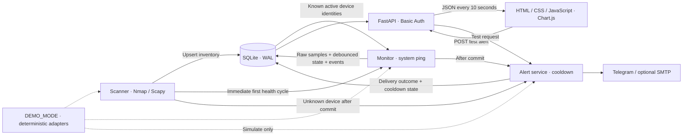
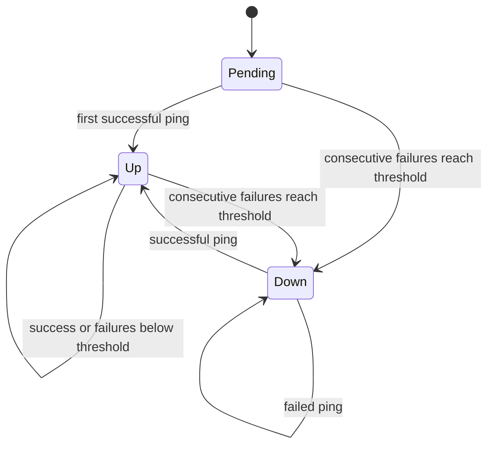

# Architecture and data flow

## Overview

Signal is a single-process FastAPI application with an in-process APScheduler, a SQLAlchemy/SQLite persistence layer, and a static vanilla JavaScript dashboard. It favors explicit scope and observable failure handling over distributed infrastructure.

The reader-facing flow is **scanner → monitor → database → API → dashboard → alerts**. Execution is not a synchronous browser-driven chain: alerts originate in the background service **after database commits**. The dashboard observes their outcomes and can independently request a test alert.

## 1. Scanner → inventory and monitor

`app/scanner.py` validates that the target is an IPv4 subnet wholly within RFC1918 space and is no larger than `/16`. With no explicit subnet, interface metadata selects an active private network. Nmap runs host discovery only, never a port scan; Scapy ARP is the fallback and only works on a directly attached network.

Results include IP/MAC, bounded reverse-DNS lookups, and offline OUI enrichment. `MonitorService` upserts identities, preferring MAC over IP. A new MAC taking an existing IP does not inherit the previous device's trust. Replaced identities are retired from the active inventory rather than erased.

Discovery does not decide that an absent device is down. A scan-tool error is an event and a summary diagnostic; existing device health is unchanged. Successful discovery commits inventory before triggering the first ping cycle.

## 2. Monitor → database

`app/monitor.py` uses a bounded thread pool and shell-free, cross-platform `ping` subprocesses. Stored IPs are rechecked against the configured private subnet before probing. A missing binary or explicit local permission error is skipped rather than fabricated as a device outage.

Each completed probe becomes a `HealthSample`. The `Device` row stores a separate debounced status:

The first missed probe starts downtime timing; only a transition into Down emits a down event. The first later success emits recovery with elapsed downtime. Raw missed samples can reduce uptime before debounced status changes.

All timestamps are stored as naive UTC for SQLite comparisons and serialized with an explicit UTC offset. Uptime is successful observed probes divided by all observed probes in 24h/7d/30d windows. No samples means null, not 100%. This is a sampled ratio, not time-weighted SLA accounting.

## 3. Database → API

`app/database.py` enables foreign keys, WAL, and a busy timeout. Request/job-scoped sessions prevent sharing a SQLAlchemy session across threads. SQL aggregates calculate uptime without loading every sample into Python. History uses bounded time buckets; any failed observation marks a mixed bucket down.

Core tables:

| Table | Responsibility |
|---|---|
| `devices` | Inventory, trust/tags, debounced status, failure counters |
| `health_samples` | Raw ping outcomes and latency, indexed by device/time |
| `events` | Activity feed and notification outcome |
| `alert_cooldowns` | Last attempt/success by notification key |

Hourly retention deletes expired samples/events and old cooldown records. Inventory and friendly-name edits persist. Schema creation is supported; schema migrations are not yet implemented.

## 4. API → dashboard

`app/api/routes.py` exposes inventory, edits, histories, events, summary, scan requests, test alerts, and CSV export. FastAPI validates payloads and generates interactive documentation.

Every route, static file, and documentation page requires HTTP Basic Auth. Mutating browser requests reject cross-origin origins. The dashboard escapes text before HTML insertion; CSV exports neutralize spreadsheet formula prefixes. Basic Auth still requires HTTPS beyond loopback.

The dashboard polls every 10 seconds with an overlap guard and preserves unsaved modal edits. Search/filter/sort can run in the browser; the REST inventory endpoint also supports those operations. Charts use a numeric time axis, explicit gaps, and observation-based availability segments. SSID metadata is read off the API request path every 30 seconds.

## 5. Alerts → providers and event log

Discovery/monitoring commit events before making network calls. `app/alerts.py` serializes notification attempts with a lock and persists cooldown state. Keys distinguish unknown, down, up, and test messages. Failed delivery uses a short backoff rather than consuming a successful-send cooldown.

Telegram is attempted first; optional SMTP is also attempted. At least one successful configured channel counts as delivered. This intentionally does not retry a failed secondary channel after another succeeds. Unknown devices are reminded on later scans until trusted. Trusted devices still receive outage/recovery alerts.

Delivery failures do not crash scheduling, but there is **no durable retry outbox** for transition alerts. A crash between provider delivery and recording success can duplicate a notification. A future outbox/idempotency design should address this.

## Demo isolation and reproducibility

`python -m app.demo` enables `DEMO_MODE=true`, generates temporary Basic Auth credentials, and binds to loopback. Configuration redirects persistence to `DEMO_DATABASE_URL` rather than the live `DATABASE_URL`; identical configured live/demo URLs are rejected. Do not deliberately point the demo URL at any existing inventory file.

`app/demo_data.py` supplies eight fictional devices, seven days of deterministic history, and repeatable ping outcomes. The same scheduler orchestration, state machine, persistence, endpoints, cooldown logic, and frontend are used. Nmap/Scapy, reverse DNS, real ping, interface metadata commands, Telegram, and SMTP are bypassed. Test alerts return `simulated`, and the dashboard visibly labels the entire session.

Seeding is idempotent: it creates data only for an empty demo inventory, preserving reviewer edits on restart. No performance or real-network reliability claims are inferred from synthetic data.

## Process model, testing, and tradeoffs

- **One worker:** APScheduler is owned by the FastAPI lifespan. Multiple workers/replicas would duplicate schedules; distributed locking is not implemented.
- **Concurrency:** separate nonblocking scan/ping locks skip overlapping cycles; a queued manual scan reserves its lock before submission.
- **Bounded external work:** Nmap has a timeout, ping has per-probe and process deadlines, and provider clients have network timeouts. Slow notification batches can still delay jobs.
- **SQLite:** low-friction local deployment and indexed queries, but single-writer contention and large fleets favor PostgreSQL/time-series storage.
- **Platform boundaries:** Linux host-mode Docker can access the LAN; Desktop virtualization, driver installation, firewalls, and endpoint sleep/ICMP policy affect visibility.
- **CI:** Ruff lint checks and pytest run on Linux, Windows, and macOS with Python 3.11/3.13 and `DEMO_MODE=true`. Fixtures use isolated SQLite databases and prevent external network/subprocess access, allowing only local event-loop IPC. Adapter tests use mocks; the demo API test runs startup orchestration without starting scheduler threads.
- **Not distributed tracing:** structured behavior is exposed through logs/events, but there are no metrics exporters, correlation IDs, or tracing backend.
